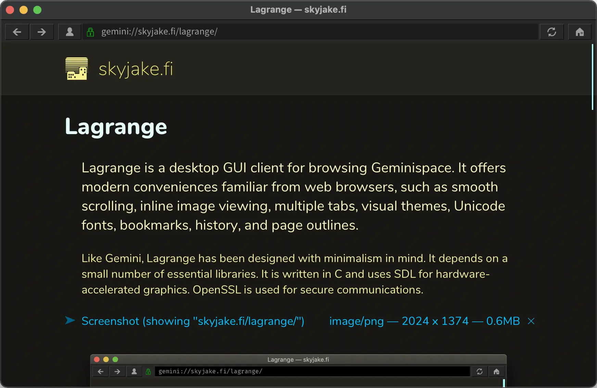

# Lagrange

Lagrange is a versatile client for browsing [Geminispace](https://geminiprotocol.net/). It offers modern conveniences familiar from web browsers, such as smooth scrolling, inline image viewing, multiple tabs, visual themes, Unicode fonts, bookmarks, history, and page outlines.

Lagrange is designed to be platform-independent. It relies on a small number of essential libraries for complex features like text rendering and cryptography. It is written in C and uses [SDL 3](https://libsdl.org/) for hardware-accelerated graphics and [OpenSSL](https://openssl.org/) for secure communications.

## Features

* Beautiful typography with full Unicode support
* Autogenerated page style and symbol for each Gemini domain
* Scrolling and paginated view modes
* Smart suggestions when typing the URL — search bookmarks, history, identities
* Sidebars for page outline, managing bookmarks, viewing history, and other features
* Identity management — create and use TLS client certificates
* Audio playback: built-in MP3, Ogg Vorbis, WAV support
* Sync user data across devices
* Gempub books
* Curses-based TUI as an alternative to the graphical interface
* And much more! Open `about:help` in the app, or see [help.gmi](https://git.skyjake.fi/gemini/lagrange/raw/branch/release/app/res/about/help.gmi)

## Downloads

Prebuilt binaries for Windows, macOS (10.13 or later) and Linux can be found in [Releases][rel]. You can also find [Lagrange on Flathub for Linux](https://flathub.org/apps/details/fi.skyjake.Lagrange).

On macOS you can install and upgrade via Homebrew:

    brew install --cask lagrange

Please check [MacPorts](https://ports.macports.org/port/lagrange/) if you are using macOS 10.12 or older.

On Fedora and any RHEL/CentOS Stream 8 and 9 derivatives (RHEL, CentOS Stream, Alma, Rocky) that have the EPEL repos enabled:

    sudo dnf install lagrange

On openSUSE Tumbleweed:

    sudo zypper install lagrange

Using GNU Guix:

    guix install lagrange

## How to compile

You need a POSIX-compatible environment to compile Lagrange, or on Windows, either MSYS2 or Visual Studio with vcpkg (see [Compiling on Windows](#compiling-on-windows)).

The required tools are a C11 compiler (e.g., Clang or GCC), CMake (3.15 or newer), `pkg-config`, and `zip`. Additional tools are required if GNU FriBidi or HarfBuzz are compiled as part of the build (see [Unicode text rendering](#unicode-text-rendering)).

1. Download and extract a source tarball from [Releases][rel].
   * Note: GitHub/Gitea-generated tarballs do not contain [the_Foundation][tf], HarfBuzz, GNU FriBidi, or SEALCurses submodules; check which tarball you are downloading.
   * Alternatively, you may also clone the repository and its submodules: `git clone --recursive --branch release https://git.skyjake.fi/gemini/lagrange`
2. Check that you have the build tools and dependencies installed: SDL 3, OpenSSL (1.1.1 or newer), PCRE2 (or the older libpcre), libunistring, and zlib. On Windows (MSYS2/MinGW) and Linux/Unix, you may also want FreeType, HarfBuzz, and GNU FriBidi (for high-fidelity text rendering), and on Linux/Unix, Fontconfig (for locating system fonts). For example,
   * on macOS using Homebrew: `brew install cmake pkgconf sdl3 openssl@3 pcre2 libunistring`
   * on Ubuntu (25.04 or newer) or Debian (13 or newer): `sudo apt install cmake zip libsdl3-dev libssl-dev libpcre2-dev zlib1g-dev libunistring-dev libfreetype-dev libharfbuzz-dev libfribidi-dev libfontconfig-dev`
   * on Fedora: `sudo dnf install cmake zip SDL3-devel openssl-devel pcre2-devel zlib-devel libunistring-devel freetype-devel harfbuzz-devel fribidi-devel fontconfig-devel`
3. Optionally, install additional libraries for audio and image formats. These are detected automatically with `pkg-config`:
   * mpg123 for MPEG audio (Homebrew: `mpg123`, Ubuntu: `libmpg123-dev`, Fedora: `mpg123-devel`)
   * opusfile for Opus audio (Homebrew: `opusfile`, Ubuntu: `libopusfile-dev`, Fedora: `opusfile-devel`)
   * libwebp for WebP images (Homebrew: `webp`, Ubuntu: `libwebp-dev`, Fedora: `libwebp-devel`)
   * libjxl for JPEG XL images (Homebrew: `jpeg-xl`, Ubuntu: `libjxl-dev`, Fedora: `libjxl-devel`)
4. Configure the build in a new build directory: `cmake -S {path_of_lagrange_sources} -B build -DCMAKE_BUILD_TYPE=Release`
5. Build it: `cmake --build build`
6. Now you can run `build/app/lagrange`, `build\app\lagrange.exe`, or `build/app/Lagrange.app`.

If SDL 3 is not found, the GUI app is not built. CMake prints a summary of the enabled options at the end of the configuration.

### Unicode text rendering

Lagrange uses the platform's native text rendering when available:

* On macOS and iOS, Core Text is used for loading fonts and for shaping and rendering text (`ENABLE_CORETEXT`). No other text rendering libraries are needed.
* On Windows and Linux/Unix, glyphs are rendered with [FreeType](https://freetype.org) (`ENABLE_FREETYPE`). Text is shaped with [HarfBuzz](https://harfbuzz.github.io), and [GNU FriBidi](https://github.com/fribidi/fribidi/) handles bidirectional text. The system-provided HarfBuzz is always used together with FreeType, because the two libraries are built to work with each other.

GNU FriBidi is located with `pkg-config`. If it is not found, it is compiled from the `lib/fribidi` submodule as part of the build. Set `ENABLE_FRIBIDI_BUILD` to **ON** to always use the submodule. Note that GNU FriBidi cannot be compiled with CMake; you need to have [Meson](https://mesonbuild.com) and [Ninja](https://ninja-build.org).

If both Core Text and FreeType are disabled, a simpler built-in font renderer (stb_truetype) is used instead. It does not support system fonts, color Emoji, or font hinting. In this configuration, HarfBuzz is located with `pkg-config`, or compiled from the `lib/harfbuzz` submodule if not found (or if `ENABLE_HARFBUZZ_MINIMAL` is set to **ON**). Compiling HarfBuzz requires a C++ compiler, and preferably Meson and Ninja.

You may also disable FreeType, HarfBuzz, and GNU FriBidi entirely. A simplified text shaping algorithm is then used that only supports non-complex left-to-right scripts.

### Installing to a custom directory

By default, the compiled app will be installed to a system-wide location determined by CMake.

Set `CMAKE_INSTALL_PREFIX` to install to a directory of your choosing:

1. `cmake -S {path_of_lagrange_sources} -B build -DCMAKE_BUILD_TYPE=Release -DCMAKE_INSTALL_PREFIX=/dest/path`
2. `cmake --build build --target install`

On Linux/Unix, the `install` target also deploys an XDG .desktop file for launching the app, an icon, AppStream metadata, and the `lagrange.1` manual page.

### Build options

| CMake Option | Default | Description |
| ------------ | ------- | ----------- |
| `ENABLE_APP_BUNDLE` | ON | Build a macOS app bundle (Lagrange.app). If set to **OFF**, the app is installed Unix-style, with the executable and resources in separate directories. (Only on macOS.) |
| `ENABLE_CORETEXT` | ON | Use Core Text for loading fonts and for shaping and rendering text. This provides access to system fonts and color Emoji. Replaces HarfBuzz and GNU FriBidi. Cannot be used together with `ENABLE_FREETYPE`. (Only on macOS and iOS.) |
| `ENABLE_CUSTOM_FRAME` | OFF | Draw a custom window frame. (Only on Microsoft Windows.) The custom frame is more in line with the visual style of the rest of the UI, but does not implement all of the native window behaviors (e.g., snapping, system menu). |
| `ENABLE_DOWNLOAD_EDIT` | ON | Allow changing the Downloads directory via the Preferences dialog. This should be set to **OFF** in sandboxed environments where downloaded files must be saved into a specific place. |
| `ENABLE_FRAME_TIMING` | OFF | Print statistics about frame timing. Useful for debugging rendering performance. |
| `ENABLE_FREETYPE` | ON (Apple: OFF) | Use the FreeType library for loading fonts and rendering glyphs. This provides access to system fonts and color Emoji. Requires the system-provided HarfBuzz. |
| `ENABLE_FRIBIDI` | ON | Use the GNU FriBidi library for processing bidirectional text. FriBidi implements the Unicode Bidirectional Algorithm to determine text directions. |
| `ENABLE_FRIBIDI_BUILD` | OFF | Compile the GNU FriBidi library from the `lib/fribidi` submodule. If set to **OFF**, `pkg-config` is used to locate the library, falling back to the submodule if it is not found. |
| `ENABLE_GAMEPAD` | ON | Allow gamepad UI input. |
| `ENABLE_GUI` | ON | Build the GUI application. Requires SDL 3. |
| `ENABLE_HARFBUZZ` | ON | Use the HarfBuzz library for shaping Unicode text. This is required for correctly rendering complex scripts and combining glyphs. If disabled, a simplified text shaping algorithm is used that only works for non-complex languages like English. (Not used with Core Text.) |
| `ENABLE_HARFBUZZ_MINIMAL` | OFF | Compile the HarfBuzz library from the `lib/harfbuzz` submodule with all dependencies disabled. Useful when building the app for distribution so that the number of deployed dependencies will be minimized. If set to **OFF**, `pkg-config` is used to locate the library, falling back to the submodule if it is not found. (Not used with FreeType or Core Text.) |
| `ENABLE_IDLE_SLEEP` | OFF | Sleep in the main thread instead of waiting for events. On some platforms, `SDL_WaitEvent()` may have a relatively high CPU usage. Setting this to **ON** polls for events periodically but otherwise keeps the main thread sleeping, reducing CPU usage. The drawback is that there is a slightly increased latency reacting to new events after idle mode ends. |
| `ENABLE_IPC` | ON | Instances of the Lagrange executable communicate via signals or (on Windows) a system-provided IPC mechanism. This is used for controlling an existing Lagrange window via the CLI. If set to **OFF**, each instance of the app runs without knowledge of other instances. This may cause them to overwrite each other's runtime files. |
| `ENABLE_JXL` | ON | Use libjxl to decode .jxl images, if `pkg-config` can find the library. |
| `ENABLE_KERNING` | ON | Use kerning information in the fonts to adjust glyph placement. Setting this **ON** improves text appearance in subtle ways but slows down text rendering. It may be a good idea to set this to **OFF** when running on a slow CPU. This option only affects the simple built-in text renderer, and has no effect on HarfBuzz, FreeType, or Core Text. |
| `ENABLE_MAC_MENUS` | ON | Use native context menus on macOS. |
| `ENABLE_MOBILE_HANDHELD` | OFF | Use the mobile handheld UI variant. Assumes that a gamepad is used for controlling the app, `ENABLE_GAMEPAD` should also be set. It is suitable for handheld game consoles, for instance. |
| `ENABLE_MOBILE_PHONE` | OFF | Use the mobile phone UI variant. This replaces the sidebars with a sliding sheet and has other touch-friendly features. Settings and dialogs are presented as form-based sheets. |
| `ENABLE_MOBILE_TABLET` | OFF | Use the tablet UI variant. Sidebars are available as on the desktop, but Settings and dialogs are presented as form-based sheets. |
| `ENABLE_MPG123` | ON | Use the mpg123 library for decoding MPEG audio files. |
| `ENABLE_OPUS` | ON | Use the opusfile library for decoding Opus audio files. |
| `ENABLE_POPUP_MENUS` | ON | Use popup windows for context menus. If **OFF**, menus are confined inside the main window. |
| `ENABLE_RELATIVE_EMBED` | OFF | Locate resources only in relation to the executable. Useful when any system/predefined directories are not supposed to be accessed, e.g., in the Windows portable build. |
| `ENABLE_RESIZE_DRAW` | ON (Haiku and Android: OFF) | Force the window to redraw while being resized. May be necessary on some platforms. |
| `ENABLE_SPARKLE` | OFF | Use the Sparkle framework for automatic updates. (macOS only) |
| `ENABLE_STATIC` | OFF | Link dependencies statically. |
| `ENABLE_TUI` | OFF | Build the TUI application (`clagrange`). The SEALCurses library is required (it replaces SDL); check that the `lib/sealcurses` submodule is checked out. |
| `ENABLE_WEBP` | ON | Use libwebp to decode .webp images, if `pkg-config` can find the library. |
| `ENABLE_WINDOWPOS_FIX` | OFF | Set correct window position after the window has already been shown. This may be necessary on some platforms to prevent the window from being restored to the wrong position. |
| `ENABLE_WINSPARKLE` | OFF | Use WinSparkle for automatic updates. (Windows only) |
| `ENABLE_X11_SWRENDER` | OFF | Default to software rendering when running under X11. By default Lagrange attempts to use the GPU for rendering the user interface. You can also use the `--sw` option at launch to force software rendering. |
| `ENABLE_X11_XLIB` | ON | Use the Xlib API directly under X11. This is used for window decoration color theming, for example. |

Additional CMake cache variables:

| Variable | Description |
| -------- | ----------- |
| `CACERT_PEM_PATH` | Path of a root CA certificate bundle (cacert.pem) to include as a built-in resource. |
| `RESOURCES_LGR_PATH` | Additional location to check when searching for the "resources.lgr" file at launch. |

### Compiling the TUI version

Lagrange also supports a text user interface (TUI) that allows running the app in a terminal. The GUI and TUI are built as separate executables. By default, the TUI is disabled in the build settings. Set the `ENABLE_TUI` option to `YES` to build the TUI executable (`clagrange`). If the GUI is not needed, you can disable it by setting `ENABLE_GUI` to `NO`.

In the TUI build, SDL is replaced with a library called [SEALCurses](https://git.skyjake.fi/skyjake/sealcurses.git) that implements a subset of the SDL API on top of [Curses](https://invisible-island.net/ncurses/). The requirements for building the TUI are otherwise the same as with the GUI, except FreeType, HarfBuzz, FriBidi, and all the image and audio dependencies will not be used.

### Sync server and gmget

The source tree also contains two command line tools:

* `lgrsyncd` is the sync server for Lagrange's user data sync. It only depends on the_Foundation. When the app is being built, `lgrsyncd` is excluded from the default build target; build it with `cmake --build build --target lgrsyncd`. Alternatively, configure the "sync" subdirectory as a separate project: `cmake -S sync -B build-sync && cmake --build build-sync`.
* `gmget` is a simple curl-like tool for making Gemini requests on the command line using Lagrange's identities and user data. It is built from the "lib/core" directory and is not installed.

See the Technical Reference (`about:reference` in the app) for usage instructions.

### Compiling on macOS

When using OpenSSL from Homebrew, you must add its pkgconfig path to your `PKG_CONFIG_PATH` environment variable, for example:

    export PKG_CONFIG_PATH=$(brew --prefix openssl@3)/lib/pkgconfig

By default, the build produces an app bundle (Lagrange.app) with SDL embedded inside it. Set `ENABLE_APP_BUNDLE` to **OFF** for a Unix-style build that can be installed under a prefix like any other command line program.

### Compiling on Windows

There are two ways to compile Lagrange on Windows: natively with Visual Studio and [vcpkg](https://vcpkg.io), or using [MSYS2](https://www.msys2.org).

#### Visual Studio and vcpkg

The required dependencies are listed in the vcpkg manifest file (vcpkg.json), so vcpkg installs them automatically during CMake configuration. CMake 3.21 or newer is required for installing the app.

1. Install the Build Tools for Visual Studio 2022 with the "Desktop development with C++" component.
2. Install vcpkg and set the `VCPKG_ROOT` environment variable to point to it.
3. Configure using the "vcpkg" preset in your source directory: `cmake --preset vcpkg`
4. Build it: `cmake --build build --config Release`
5. Optionally, install to a directory of your choosing. This also deploys the needed DLLs: `cmake --install build --config Release --prefix C:\dest\path`

#### MSYS2

You should use a version of the SDL 3 library that is compiled for native Windows (i.e., the MSVC variant) instead of the version from MSYS2 or MinGW. You can download a copy of the SDL binaries from [libsdl.org](https://libsdl.org/). To make configuration easier in your MSYS2 environment, consider writing a custom sdl3.pc file so `pkg-config` can automatically find the correct version of SDL. Below is an example of what your sdl3.pc might look like:

    prefix=/c/SDK/SDL3-3.2.0/
    arch=x64
    libdir=${prefix}/lib/${arch}/
    incdir=${prefix}/include/

    Name: sdl3
    Description: Simple DirectMedia Layer
    Version: 3.2.0-msvc
    Libs: ${libdir}/SDL3.dll -mwindows
    Cflags: -I${incdir}

The `-mwindows` option is particularly important as that specifies the target is a GUI application. Also note that you are linking directly against the Windows DLL — do not use any prebuilt .lib files if available, as those as specific to MSVC.

`pkg-config` will find your .pc file if it is on `PKG_CONFIG_PATH` or you place it in a system-wide pkgconfig directory.

Once you have compiled a working binary under MSYS2, there is still an additional step required to allow running it directly from the Windows shell: the shared libraries from MSYS2 must be found either via `PATH` or by copying them to the same directory where _lagrange.exe_ is located.

### Compiling on Raspberry Pi

On Raspberry Pi 4/400 and newer, you can compile and run Lagrange just like on a regular desktop PC. Accelerated OpenGL graphics should work fine under X11.

On Raspberry Pi 3 or earlier, you should use a version of SDL that is compiled to take advantage of the Broadcom VideoCore OpenGL ES hardware. This provides the best performance when running Lagrange in a console. OpenGL under X11 on Raspberry Pi 2/3 is quite slow/experimental. When running under X11, software rendering is the best choice and the SDL from, say, Raspberry Pi OS is sufficient.

The following build options are recommended on Raspberry Pi 2/3:

* `ENABLE_WINDOWPOS_FIX=YES`: workaround for window position restore issues (SDL bug)
* `ENABLE_X11_SWRENDER=YES`: use software rendering under X11

[rel]: https://git.skyjake.fi/gemini/lagrange/releases
[tf]:  https://git.skyjake.fi/skyjake/the_Foundation

### Compiling on iOS

Compiling Lagrange on iOS is moderately difficult.

As a prerequisite, you will need to have an [iOS toolchain configuration for CMake](https://github.com/leetal/ios-cmake). CMake is required for Lagrange itself and for the\_Foundation. You will also need [Autotools helpers for iOS](https://github.com/szanni/ios-autotools.git) because libiconv, libunistring, and libpcre use Automake. The _iconfigure_ script in the Autotools helpers needs to be [patched](platform/iconfigure-osminver.patch). HarfBuzz and GNU FriBidi are not needed because text is rendered with Core Text.

After these utilities are available, the scripts in _platform/_ can be used as a basis for the build. Unfortunately there is no ready-made high-level script for performing all these steps, so you'll need to adapt them individually to your needs.

1. _platform/ios-deps.sh_ compiles most of the dependencies using _iconfigure_. Note that the simulator build has not been set up in these scripts, only the `os` build.
2. Clone [OpenSSL for iPhone](https://github.com/x2on/OpenSSL-for-iPhone.git) and build it. Deploy the static libraries in _$HOME/SDK/ios/$arch/_, or wherever you've set `IOS_DIR` to be.
3. Build SDL 3 as a framework and place SDL3.framework and the SDL headers (_include/SDL3_) in `IOS_DIR`.
4. Create an empty build directory for the\_Foundation and run _platform/cmake-ios-tf.sh_ from there. You may need to adjust the source directory path in the script depending on where you place your build directory.
5. Now you can `make install` to build and deploy the_Foundation to `IOS_DIR`.
6. Finally, you can run CMake like in _platform/cmake-ios-lagrange.sh_ to generate an Xcode project that builds the app.

### Compiling for the web

Lagrange can be compiled to WebAssembly with [Emscripten](https://emscripten.org/) and run in a web browser. You will need the Emscripten SDK, CMake, Ninja, and Meson (for HarfBuzz and FriBidi, which are built from the _lib/_ submodules).

1. Activate the Emscripten environment: `source /path/to/emsdk/emsdk_env.sh`
2. Run _platform/wasm-deps.sh_ to download and compile the dependencies. They are installed in _$HOME/SDK/wasm/_ by default; give a different prefix as an argument if needed, and set `WASM_DIR` to match when building the app.
3. Run _platform/wasm-site.sh_ to build the desktop, phone, and tablet variants of the app and assemble them into a static site under _build-web/site/_.

Alternatively, a single variant can be configured manually with `emcmake cmake -S . -B build-web -G Ninja` and built with `cmake --build build-web`. The output files are in _build-web/app/_.

The app uses threads, so the web server must send the `Cross-Origin-Opener-Policy: same-origin` and `Cross-Origin-Embedder-Policy: require-corp` headers for the page to be cross-origin isolated. Browsers cannot open direct connections to Gemini servers, so network traffic goes through a WebSocket relay; see [lagrange-relay](https://git.skyjake.fi/skyjake/lagrange-relay) for the server.

## User files

One instance of Lagrange can be running at a time per user directory.

On Windows, user files are stored in _%HOMEPATH%/AppData/Roaming/fi.skyjake.Lagrange/_, unless one is using the portable distribution and there is a _userdata/_ subdirectory present in the executable directory.

On macOS, user files are stored in _~/Library/Application Support/fi.skyjake.Lagrange/_.

On Linux/*BSD/other operating systems, user files are stored in _~/.config/lagrange/_ unless you have customized the XDG directories, in which case the `XDG_CONFIG_HOME` environment variable is used to determine where user files are saved.

The usage and contents of the user files are described in the Technical Reference (`about:reference` in the app). You can delete one or more of the files while Lagrange is not running to reset the corresponding data to the default/empty state.
